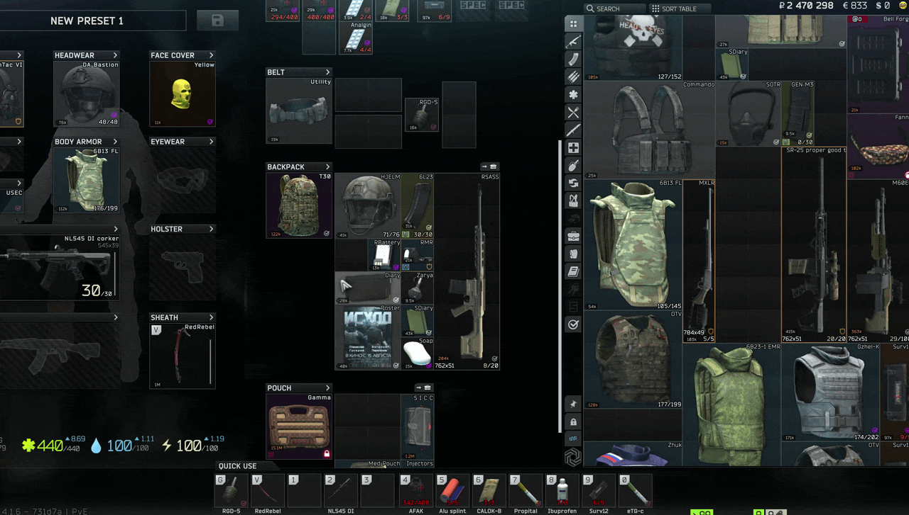

# Flogger

Right click an item and pick **Quick sell**. Flogger sends it to the flea or to the trader who pays the most, whichever gets you more money. The menu shows where it's going and for how much before you click.

## Intended to be used with Better Flea

Flogger is made to be used with [Better Flea](https://sp-mod.com/mod/3177/better-flea) and [Price Index](https://github.com/MrFums/PriceIndex). With Better Flea 2.3.0 or newer on the server, the flea price is Better Flea's own price for that exact item, and Price Index shows you the same number.

Flogger also works without either mod, using the normal flea prices.

## What it does
- Lists flea items at 85% of their value by default, which Better Flea sells within seconds. The flea fee is taken into account.
- Without Better Flea, only uses the flea if it pays at least 10% more than the best trader, since flea money arrives later by mail. With Better Flea on Near instant, the flea wins whenever it pays more.
- Works on single items, UI Fixes multi-selections, guns, and bags or rigs. A bag with things in it asks first, then sells everything inside and the empty bag.
- If you run out of flea offer slots, the slots go to the items that gain the most over the trader.
- If the flea can't take something (banned, not found in raid, no free slots), it tells you why and how much less a trader pays before selling it to them.
- If the flea is still locked for you, the menu shows what it would have paid.

## Install
SPT 4.1.x, client only. Extract the zip into your SPT folder. It goes to `BepInEx\plugins\Flogger`.

To remove it, delete that folder. Don't install it on a Fika headless client.

## Settings
Press **F12** in game > Fums-Flogger.

- **Sell to**: whoever pays most, traders only, or flea only.
- **Sell speed** (only shown with Better Flea): Near instant (85%), Fast (90%), Normal (100%), Max profit (110%), or Custom.
- **Flea listing price**: a % slider, used without Better Flea or when Sell speed is Custom.
- **Flea must pay this much more**: 10% by default. Not used with Better Flea on Near instant, since those listings sell within seconds.
- **If the flea cannot take an item**: ask, sell it to a trader, or keep it.
- **Include Fence** and **show where it goes in the menu**.
- **Quick sell key**: hold it (Space by default) and left click an item to sell it to the best trader, or right click to list it on the flea. If the flea can't take it, you get the same question as from the menu.
- **Show Quick sell in the item menu**: turn it off to only use the key.

## Compatibility
- Better Flea 2.3.0 or newer for its prices. Older versions work, but Flogger uses the normal flea prices.
- Works with Price Index and UI Fixes.
- No known incompatibilities. Not tested with Fika.

## Reporting issues
Please report issues in my Discord thread on the SPT server [here](https://discord.com/channels/875684761291599922/1562201063535415536), in this mods issue section, or on [GitHub issues](https://github.com/MrFums/Flogger/issues).

**Disclaimer:** Flogger was made with help from Claude, an AI model by Anthropic. Claude helped with the code, the code review, and the docs.
